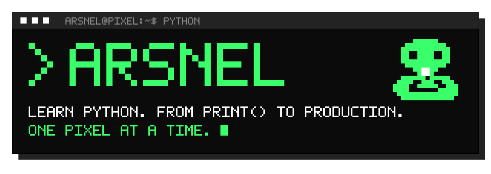
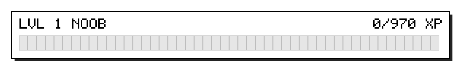
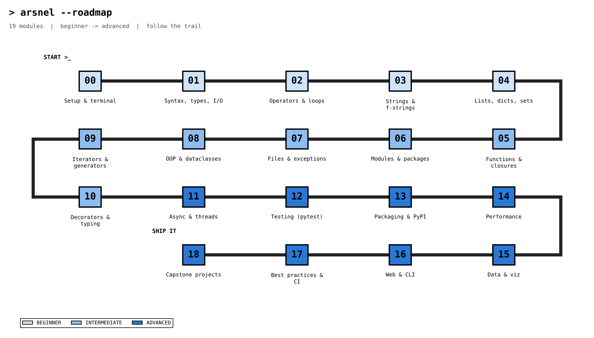
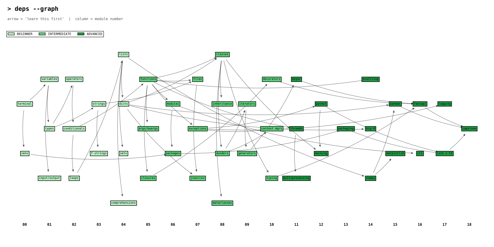
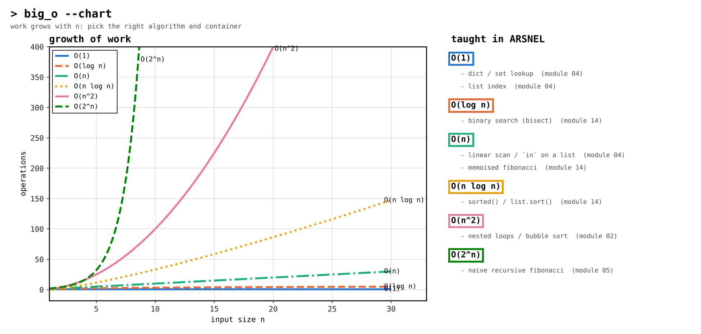
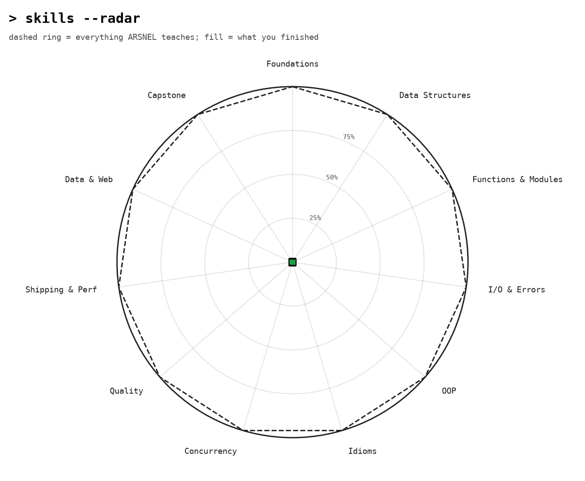
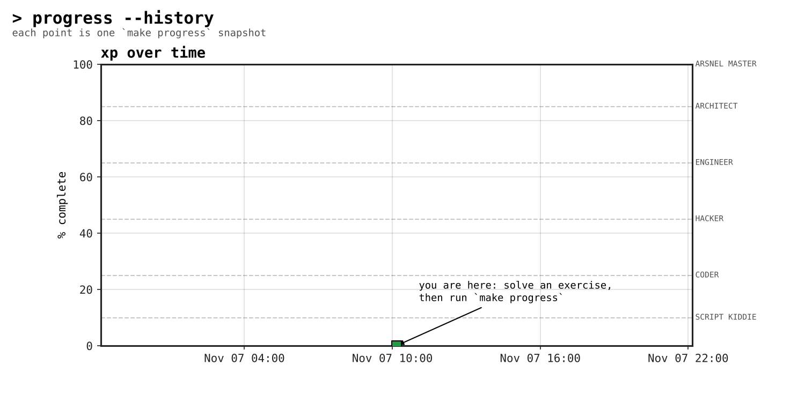
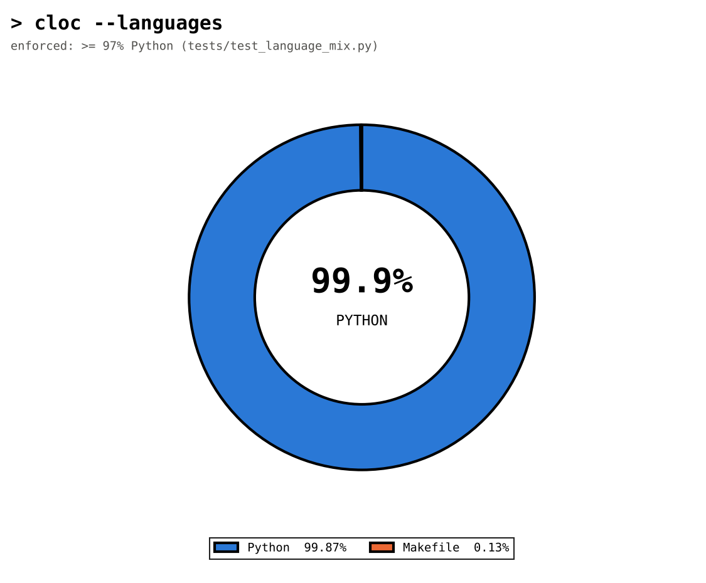

<!-- GENERATED by build_readme.py - edit the generator, not this file -->
<p align="center"></p>

```text
  ██████    ████████      ████████  ██      ██  ██████████  ██
██      ██  ██      ██  ██          ████    ██  ██          ██
██      ██  ██      ██  ██          ██  ██  ██  ██          ██
██████████  ████████      ██████    ██    ████  ████████    ██
██      ██  ██  ██              ██  ██      ██  ██          ██
██      ██  ██    ██            ██  ██      ██  ██          ██
██      ██  ██      ██  ████████    ██      ██  ██████████  ██████████

  > Learn Python. From `print()` to production. One pixel at a time.
  $ python bootstrap.py █
```

<p align="center"><b>ARSNEL — Learn Python. From <code>print()</code> to production. One pixel at a time.</b></p>

<p align="center"><code>19 modules</code> · <code>59 exercises</code> · <code>19 quizzes</code> · <code>16 badges</code> · <code>99.9% Python</code> · <code>MIT</code></p>

## > xp_status

<p align="center"></p>

```text
[░░░░░░░░░░░░░░░░░░░░░░░░░░░░░░░░░░░░░░░░]   0.0%
LVL 1  NOOB
XP 0/970   exercises 0/59   quizzes 0/19   badges 0/16
```

> Fresh clone = 0 XP. Solve an exercise, run `make progress`, and this bar (plus the charts below) updates - CI does the same on every push to your fork.

## > why_arsnel

- **Everything runs.** Every example, solution and exercise self-check is a real, typed, linted Python file. CI executes all of them.
- **Learn by doing.** Each module: lesson README -> runnable `examples/` -> `exercises/` with `# TODO` stubs that grade themselves -> a terminal `quiz.py`.
- **Measured progress.** XP, ranks and badges are computed from what you actually solved, not what you clicked.
- **100% Python tooling.** The site, charts, ASCII art, quizzes and even this README are generated by Python (>= 97% of the repo, enforced by a test).
- **Pixel/terminal aesthetic** because learning should feel like hacking the planet.

## $ quickstart

```bash
git clone https://github.com/your-org/ARSNEL && cd ARSNEL
python bootstrap.py              # venv + deps + generated files (or: make setup)
source .venv/bin/activate        # Windows: .venv\Scripts\activate
cd curriculum/module_01_syntax
python examples/hello_world.py
python exercises/ex_01_greeting.py   # FAIL until you solve the TODO
python quiz.py
make progress                    # update XP bar, charts and README
make site && python -m http.server -d site 8000
```

## > curriculum

| # | module | level | hours | exercises | XP |
| ---: | --- | --- | ---: | --- | ---: |
| 00 | [Setup & the terminal](curriculum/module_00_setup/README.md) | Beginner | 1.5 | `░░░░░░░░░░` 0/4 | 60 |
| 01 | [Syntax, variables, types & I/O](curriculum/module_01_syntax/README.md) | Beginner | 3 | `░░░░░░░░░░` 0/3 | 50 |
| 02 | [Operators, conditionals & loops](curriculum/module_02_control_flow/README.md) | Beginner | 3 | `░░░░░░░░░░` 0/3 | 50 |
| 03 | [Strings & formatting](curriculum/module_03_strings/README.md) | Beginner | 2.5 | `░░░░░░░░░░` 0/3 | 50 |
| 04 | [Lists, tuples, sets, dicts & comprehensions](curriculum/module_04_collections/README.md) | Beginner | 4 | `░░░░░░░░░░` 0/4 | 60 |
| 05 | [Functions, *args/**kwargs, lambdas & closures](curriculum/module_05_functions/README.md) | Intermediate | 3.5 | `░░░░░░░░░░` 0/3 | 50 |
| 06 | [Modules, packages, venv, pip & project layout](curriculum/module_06_modules/README.md) | Intermediate | 3 | `░░░░░░░░░░` 0/3 | 50 |
| 07 | [Files, JSON, CSV, pathlib & exceptions](curriculum/module_07_files_errors/README.md) | Intermediate | 4 | `░░░░░░░░░░` 0/3 | 50 |
| 08 | [OOP: classes, dunders, inheritance, dataclasses & protocols](curriculum/module_08_oop/README.md) | Intermediate | 5 | `░░░░░░░░░░` 0/3 | 50 |
| 09 | [Iterators, generators, itertools & functools](curriculum/module_09_iterators/README.md) | Intermediate | 4 | `░░░░░░░░░░` 0/3 | 50 |
| 10 | [Decorators, context managers & typing](curriculum/module_10_decorators/README.md) | Intermediate | 4.5 | `░░░░░░░░░░` 0/3 | 50 |
| 11 | [Async/await, threads & multiprocessing](curriculum/module_11_concurrency/README.md) | Advanced | 5 | `░░░░░░░░░░` 0/3 | 50 |
| 12 | [Testing: pytest, fixtures, mocking & TDD](curriculum/module_12_testing/README.md) | Advanced | 4 | `░░░░░░░░░░` 0/3 | 50 |
| 13 | [Packaging, pyproject.toml & publishing to PyPI](curriculum/module_13_packaging/README.md) | Advanced | 3.5 | `░░░░░░░░░░` 0/3 | 50 |
| 14 | [Performance: profiling, caching, Big-O & numpy basics](curriculum/module_14_performance/README.md) | Advanced | 4.5 | `░░░░░░░░░░` 0/3 | 50 |
| 15 | [Data & viz: pandas, matplotlib & Plotly](curriculum/module_15_data_viz/README.md) | Advanced | 5 | `░░░░░░░░░░` 0/3 | 50 |
| 16 | [Web: FastAPI & a tiny CLI tool](curriculum/module_16_web/README.md) | Advanced | 5 | `░░░░░░░░░░` 0/3 | 50 |
| 17 | [Best practices: clean code, logging, ruff/black/mypy & CI](curriculum/module_17_best_practices/README.md) | Advanced | 4 | `░░░░░░░░░░` 0/3 | 50 |
| 18 | [Capstone projects](curriculum/module_18_capstones/README.md) | Advanced | 12 | `░░░░░░░░░░` 0/3 | 50 |

## > charts

### Learning-path roadmap



### Concept dependency graph



### Big-O complexity



### Skill radar



### Progress over time



### Repository languages



## > achievements

```text
░░░░░░░░░░░░░░  ░░░░░░░░░░░░░░  ░░░░░░░░░░░░░░  ░░░░░░░░░░░░░░
░░  ░░  ░░  ░░  ░░  ░░  ░░  ░░
░░  ░░░░░░  ░░  ░░  ░░░░░░  ░░  ░░  ░░░░░░  ░░  ░░  ░░░░░░  ░░
░░░░      ░░░░  ░░░░      ░░░░  ░░░░      ░░░░  ░░░░      ░░░░
░░        ░░░░  ░░        ░░░░  ░░        ░░░░  ░░        ░░░░
░░      ░░  ░░  ░░      ░░  ░░  ░░      ░░  ░░  ░░      ░░  ░░
░░    ░░    ░░  ░░    ░░    ░░  ░░    ░░    ░░  ░░    ░░    ░░
░░          ░░  ░░          ░░  ░░          ░░  ░░          ░░
░░    ░░    ░░  ░░    ░░    ░░  ░░    ░░    ░░  ░░    ░░    ░░
░░  ░░  ░░  ░░  ░░  ░░  ░░  ░░
░░░░░░░░░░░░░░  ░░░░░░░░░░░░░░  ░░░░░░░░░░░░░░  ░░░░░░░░░░░░░░
    LOCKED          LOCKED          LOCKED          LOCKED

░░░░░░░░░░░░░░  ░░░░░░░░░░░░░░  ░░░░░░░░░░░░░░  ░░░░░░░░░░░░░░
░░  ░░  ░░  ░░  ░░  ░░  ░░  ░░
░░  ░░░░░░  ░░  ░░  ░░░░░░  ░░  ░░  ░░░░░░  ░░  ░░  ░░░░░░  ░░
░░░░      ░░░░  ░░░░      ░░░░  ░░░░      ░░░░  ░░░░      ░░░░
░░        ░░░░  ░░        ░░░░  ░░        ░░░░  ░░        ░░░░
░░      ░░  ░░  ░░      ░░  ░░  ░░      ░░  ░░  ░░      ░░  ░░
░░    ░░    ░░  ░░    ░░    ░░  ░░    ░░    ░░  ░░    ░░    ░░
░░          ░░  ░░          ░░  ░░          ░░  ░░          ░░
░░    ░░    ░░  ░░    ░░    ░░  ░░    ░░    ░░  ░░    ░░    ░░
░░  ░░  ░░  ░░  ░░  ░░  ░░  ░░
░░░░░░░░░░░░░░  ░░░░░░░░░░░░░░  ░░░░░░░░░░░░░░  ░░░░░░░░░░░░░░
    LOCKED          LOCKED          LOCKED          LOCKED

░░░░░░░░░░░░░░  ░░░░░░░░░░░░░░  ░░░░░░░░░░░░░░  ░░░░░░░░░░░░░░
░░  ░░  ░░  ░░  ░░  ░░  ░░  ░░
░░  ░░░░░░  ░░  ░░  ░░░░░░  ░░  ░░  ░░░░░░  ░░  ░░  ░░░░░░  ░░
░░░░      ░░░░  ░░░░      ░░░░  ░░░░      ░░░░  ░░░░      ░░░░
░░        ░░░░  ░░        ░░░░  ░░        ░░░░  ░░        ░░░░
░░      ░░  ░░  ░░      ░░  ░░  ░░      ░░  ░░  ░░      ░░  ░░
░░    ░░    ░░  ░░    ░░    ░░  ░░    ░░    ░░  ░░    ░░    ░░
░░          ░░  ░░          ░░  ░░          ░░  ░░          ░░
░░    ░░    ░░  ░░    ░░    ░░  ░░    ░░    ░░  ░░    ░░    ░░
░░  ░░  ░░  ░░  ░░  ░░  ░░  ░░
░░░░░░░░░░░░░░  ░░░░░░░░░░░░░░  ░░░░░░░░░░░░░░  ░░░░░░░░░░░░░░
    LOCKED          LOCKED          LOCKED          LOCKED

░░░░░░░░░░░░░░  ░░░░░░░░░░░░░░  ░░░░░░░░░░░░░░  ░░░░░░░░░░░░░░
░░  ░░  ░░  ░░  ░░  ░░  ░░  ░░
░░  ░░░░░░  ░░  ░░  ░░░░░░  ░░  ░░  ░░░░░░  ░░  ░░  ░░░░░░  ░░
░░░░      ░░░░  ░░░░      ░░░░  ░░░░      ░░░░  ░░░░      ░░░░
░░        ░░░░  ░░        ░░░░  ░░        ░░░░  ░░        ░░░░
░░      ░░  ░░  ░░      ░░  ░░  ░░      ░░  ░░  ░░      ░░  ░░
░░    ░░    ░░  ░░    ░░    ░░  ░░    ░░    ░░  ░░    ░░    ░░
░░          ░░  ░░          ░░  ░░          ░░  ░░          ░░
░░    ░░    ░░  ░░    ░░    ░░  ░░    ░░    ░░  ░░    ░░    ░░
░░  ░░  ░░  ░░  ░░  ░░  ░░  ░░
░░░░░░░░░░░░░░  ░░░░░░░░░░░░░░  ░░░░░░░░░░░░░░  ░░░░░░░░░░░░░░
    LOCKED          LOCKED          LOCKED          LOCKED
```

## > mascot

Meet **ARS**, the pixel snake who guards your progress bar:

```text
          ████████████
      ████████████████████
    ████████████████████████
    ████    ████████    ████
    ████    ████████    ████
    ████████████████████████
      ████████████████████
          ████▒▒▒▒████
            ██▒▒▒▒██
    ████████████  ██████████
  ████████    ██████    ██████
████████    ██████████    ██████
████████              ██████████
  ██████████████████████████████
    ██████████████████████████
```

## > how_it_works

```text
ARSNEL/
├── README.md                 <- generated by build_readme.py
├── build_site.py             <- Python-only static site generator
├── progress.py               <- scans exercises -> XP, charts, README
├── generate.py               <- content/*.py -> READMEs, exercise stubs, quizzes
├── bootstrap.py              <- one-command setup
├── arsnel/                   <- engine: quiz, progress, pixel art, themes
├── content/                  <- every lesson, quiz question and blurb as Python data
├── curriculum/module_NN_*/   <- README.md, examples/, exercises/, solutions/, quiz.py
├── charts/                   <- six matplotlib chart scripts
├── assets/                   <- generated SVGs and PNG/SVG charts
├── tests/                    <- pytest suite (incl. the >=97% Python check)
└── .github/workflows/ci.yml  <- ruff, black, mypy, pytest, site, progress
```

1. Authors edit `content/module_NN.py` (prose + quizzes) and hand-written `examples/` + `solutions/`.
2. `python generate.py` renders module READMEs, derives the exercise stubs from the solutions (`# --- solution ---` regions) and writes `quiz.py`.
3. `python progress.py` runs every exercise, awards XP and redraws charts.
4. `python build_site.py` renders the Jinja2/Markdown static site into `site/`.

## > contributing

Read [CONTRIBUTING.md](CONTRIBUTING.md). Quality gate: `make check` (ruff, black, mypy, pytest, generator drift). Licensed under [MIT](LICENSE).

```text
$ exit 0 █
```
